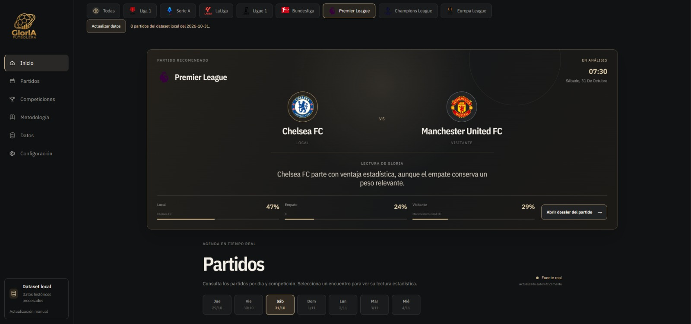
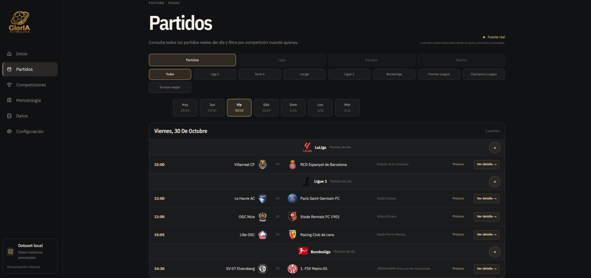
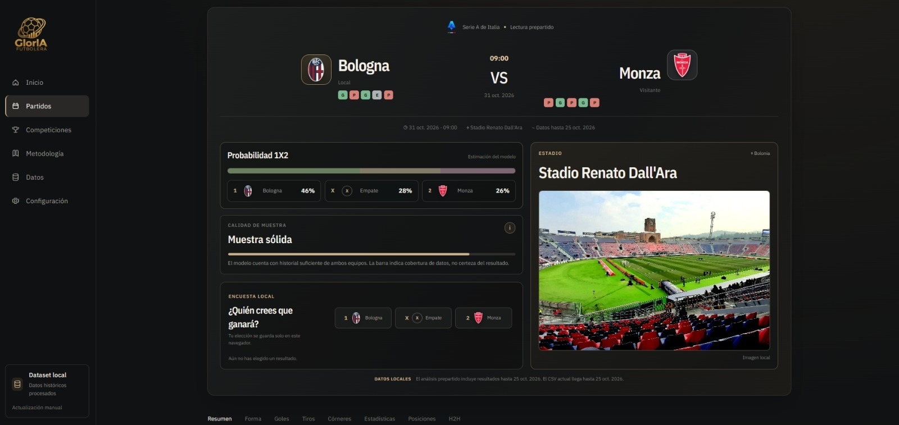
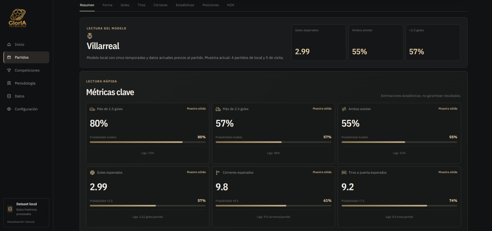
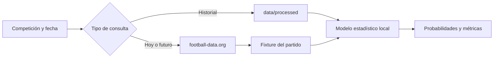

<p align="center">
  
</p>

<h1 align="center">GlorIA Futbolera</h1>

<p align="center">
  Estadísticas para entender el partido antes del pitazo inicial.
</p>

<p align="center">
  
  
  
  
</p>

<p align="center">
  <a href="#empezar">Empezar</a> ·
  <a href="#qué-puedes-consultar">Qué puedes consultar</a> ·
  <a href="docs/historical-data.md">Metodología y datos</a>
</p>

<p align="center">
  
</p>

<p align="center"><strong>Inicio.</strong> El menú lateral organiza las secciones principales; el partido recomendado resume el encuentro destacado y sus probabilidades.</p>

GlorIA Futbolera es una aplicación web de análisis estadístico prepartido. Elige una competición, consulta su calendario y abre un encuentro para revisar probabilidades, métricas y contexto histórico.

El modelo busca ser transparente: muestra de dónde salen los datos, cuánto historial tiene y cuándo una métrica no está disponible. Sus estimaciones describen tendencias; no garantizan resultados.

## Qué puedes consultar

| Área | Incluye |
| --- | --- |
| Agenda | Partidos por competición y fecha, con calendario actual para las ligas conectadas. |
| Resultado 1X2 | Probabilidades de victoria local, empate y victoria visitante. |
| Goles | Goles esperados y líneas de más de 1.5, 2.5 y 3.5 goles. |
| Ambos anotan | Probabilidad de que ambos equipos marquen. |
| Córneres | Media esperada y líneas de córneres. |
| Tiros a puerta | Estimación por equipo y total. |
| Contexto | Forma reciente, posición, enfrentamientos y rendimiento local/visitante cuando hay datos. |

## Recorrido visual

### Partidos del día



La vista **Partidos** reúne los encuentros del día y permite cambiar la fecha o filtrar por competición. Cada bloque agrupa los partidos por liga, con horario, equipos y acceso al análisis disponible.

### Detalle del encuentro



Al abrir un encuentro, la ficha presenta el pronóstico 1X2, el estado de la muestra y el contexto del estadio. La imagen del recinto complementa la lectura; la calidad de muestra indica cuántos datos respaldan el análisis.

### Métricas y secciones del análisis



La pestaña **Resumen** reúne las probabilidades de más de 1.5 y 2.5 goles, ambos anotan, goles esperados, córneres esperados y tiros a puerta esperados. Las pestañas superiores permiten ampliar la lectura con forma, goles, tiros, córneres, estadísticas, posiciones y enfrentamientos directos (H2H).

## Cobertura y fuentes

El análisis local está disponible para Bundesliga, LaLiga, Ligue 1, Premier League y Serie A. Cada dataset combina temporadas históricas desde 2021/2022 hasta 2025/2026 con los registros disponibles de la temporada actual 2026/2027.

Los partidos de hoy y fechas futuras de esas cinco ligas se consultan en football-data.org. Para habilitar esa agenda, configura `FOOTBALL_DATA_KEY`. La clave se usa en el servidor y no se envía al navegador. Sin ella, puedes iniciar la app y consultar análisis con los datasets locales; la agenda actual puede quedar vacía.

Liga 1 de Perú, Champions League y Europa League aparecen en el catálogo, pero todavía no tienen análisis local conectado en la agenda principal. La cobertura real por competencia está definida en [`data/metadata/datasets.ts`](data/metadata/datasets.ts).



## Empezar

Requisitos: Node.js 20.9 o posterior y npm.

```bash
npm install
npm run dev
```

Abre [http://localhost:3000](http://localhost:3000).

Para consultar fixtures actuales, crea `.env.local` en la raíz:

```dotenv
FOOTBALL_DATA_KEY=tu_clave_de_football_data
```

Reinicia el servidor después de agregar la clave. No subas `.env.local` ni claves al repositorio.

## Cómo se calcula

El análisis usa partidos finalizados antes de la fecha del encuentro. Las medias de ataque y defensa se ajustan por localía y se suavizan con la media de la liga cuando la muestra es pequeña. La distribución de Poisson estima marcadores y mercados de goles; BTTS deriva de las probabilidades de gol de cada equipo. Córneres y tiros a puerta usan sus propios datos históricos.

La temporada actual aporta forma reciente con peso limitado. Las variables de cada partido se calculan con un corte previo al encuentro, para evitar que el modelo use resultados futuros. Si faltan observaciones, la interfaz muestra `Sin dato` o `Mercado no disponible`; no los sustituye por cero.

Consulta fórmulas, validación y actualización de temporadas en [`docs/historical-data.md`](docs/historical-data.md).

## Comandos

| Comando | Uso |
| --- | --- |
| `npm run dev` | Iniciar el entorno local. |
| `npm run build` | Crear el build de producción con Webpack. |
| `npm run typecheck` | Comprobar tipos TypeScript. |
| `npm run lint` | Revisar estilo y reglas de ESLint. |
| `npm test` | Ejecutar pruebas del modelo estadístico. |
| `npm run validate:data` | Validar datasets procesados. |
| `npm run validate:teams` | Revisar identidades y aliases de equipos. |
| `npm run backtest` | Ejecutar evaluación temporal del modelo. |

Para actualizar los datos de una liga, sigue el procedimiento con respaldo y validación descrito en [`docs/historical-data.md`](docs/historical-data.md). Los JSON de `data/processed/` son derivados: no los edites manualmente.

## Organización del proyecto

```text
app/                 Rutas App Router; grupos (public) y (account) conservan las URLs
components/layout/    Navegación y componentes compartidos de estructura
features/            Componentes y servicios agrupados por dominio
data/metadata/       Catálogos y metadatos de equipos y ligas
data/raw/            CSV fuente por competición
data/processed/      Datasets y estadísticas normalizados
public/              Recursos servidos por URL, agrupados por tipo
docs/                Metodología, especificaciones e imágenes de referencia
lib/supabase/        Adaptadores de infraestructura Supabase
scripts/             Normalización, validación y backtesting
tests/               Pruebas del modelo estadístico
```

## Límites del modelo

- Es una lectura estadística, no una predicción segura ni una recomendación de apuestas.
- No incluye lesiones, alineaciones confirmadas, clima ni cambios de plantel en tiempo real.
- La temporada en curso es parcial; el tamaño de muestra aparece en el análisis.
- El calendario depende de la disponibilidad y cobertura de football-data.org.

<p align="center"><sub>Hecho para mirar el fútbol con más contexto y menos humo.</sub></p>
